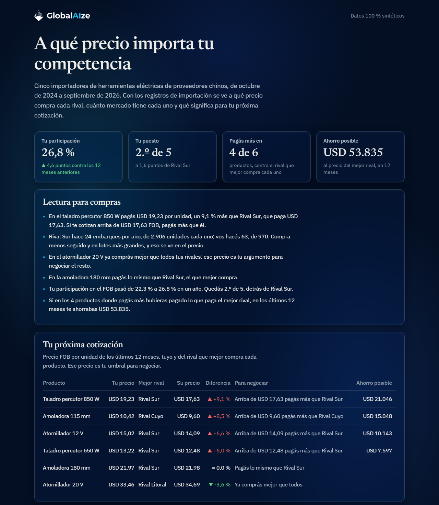
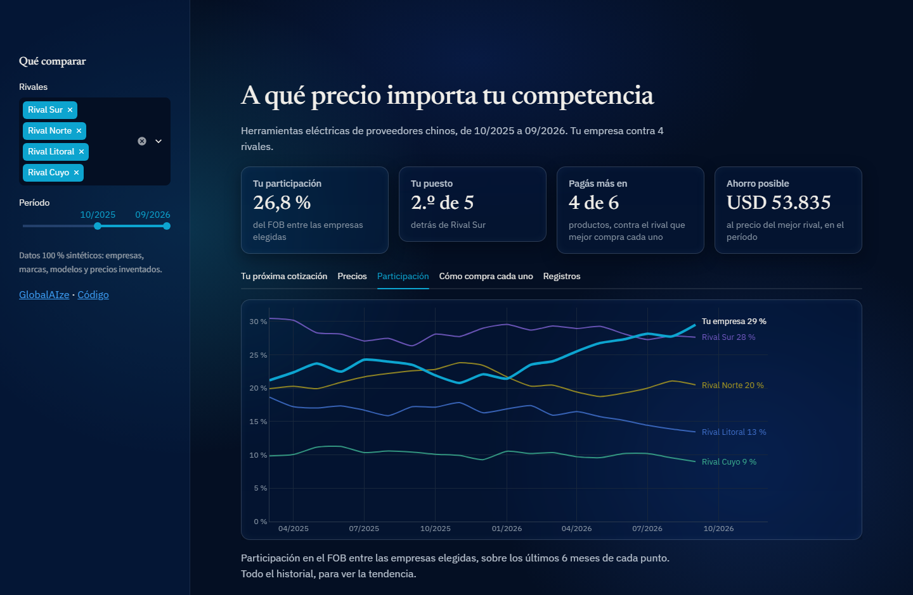
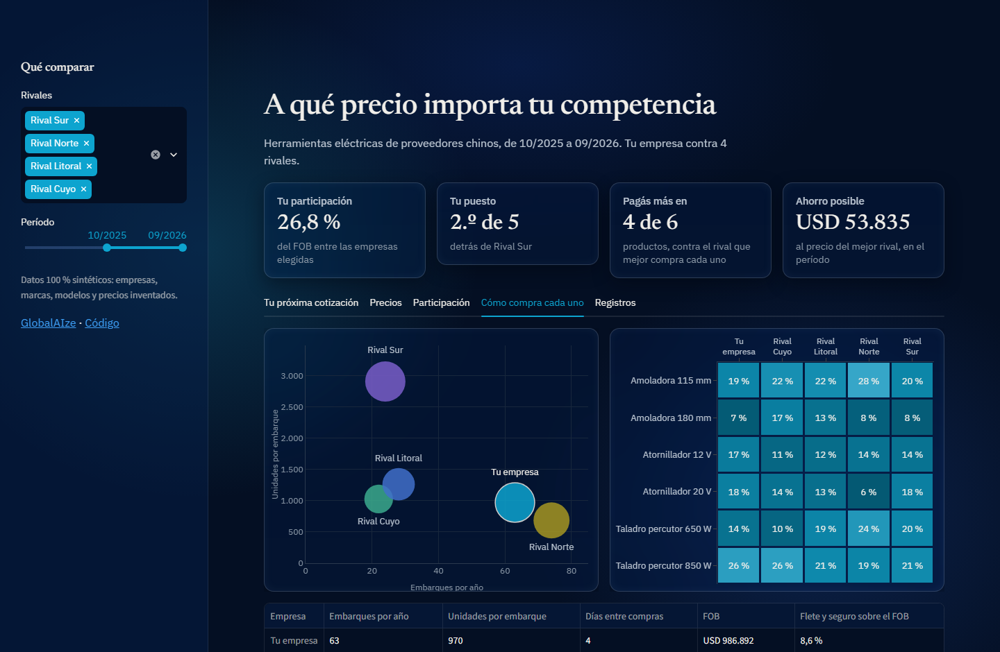

# competitor-import-benchmark

<p>
  <a href="README.md"></a>
  <a href="README.es.md"></a>
</p>

**Mirá a qué precio importa tu competencia lo mismo que vos, cuánto mercado tiene cada uno y qué significa para tu próxima cotización.**
Por [GlobalAIze](https://www.globalaize.com). Datos 100 % sintéticos. Corre sin archivos externos y sin API keys.

[](https://github.com/mauroemartinez/competitor-import-benchmark/actions/workflows/ci.yml)
[](LICENSE)



**[Abrir el informe en vivo](https://mauroemartinez.github.io/competitor-import-benchmark/)**

## El problema

Todo importador que recibe una cotización se pregunta lo mismo: ¿es buen precio? La respuesta ya está en los registros de importación, porque tus rivales traen los mismos productos y declaran lo que pagan. Pero los registros, tal como llegan, cuestan leerlos:

- **Cada importador describe el mismo producto a su manera**, y cada marca usa sus propios modelos. "TALADRO PERC. 850 W" y "TALADRO/PERCUTOR DE 850 W 13 MM" son el mismo taladro.
- **Cuando un ítem aduanero junta varios modelos, muchas veces el valor entero figura en una sola línea** y las demás quedan en cero. Leído así, el precio por modelo sale mal, a veces por mucho.
- **Un importador grande que compra pocos lotes enormes hace saltar la participación** de un trimestre a otro y tapa la tendencia.

## Qué responde

- A qué precio importa cada rival cada producto, FOB y CIF por unidad.
- **Arriba de qué cotización pagás más que el rival que mejor compra.** Ese precio es tu umbral para la próxima negociación.
- Tu participación de mercado frente a la de ellos, y hacia dónde va.
- Cómo compra cada uno: cada cuánto, en qué lotes y cuánto le cuestan el flete y el seguro.
- Qué trae cada uno, producto por producto.
- Cuánto te habrías ahorrado al precio del mejor rival.

## Cómo funciona

1. **Reconocer el producto.** El producto se identifica por su tipo y su potencia o medida, leídos de la descripción, no por el modelo. Así se compara lo mismo con lo mismo, lo escriba como lo escriba cada importador.
2. **Repartir los valores concentrados.** Cuando el valor de un ítem figura en una sola línea, se reparte entre sus líneas por cantidad por un precio de referencia de cada producto: el que paga ese mismo importador en las líneas que traen su propio valor, o el del mercado si no hay. Como los datos son sintéticos, se conoce el valor verdadero de cada línea y el reparto se puede auditar:

   | Forma de repartir | Error promedio por línea |
   |---|---|
   | Cantidad por precio de referencia (este repo) | **1,5 %** |
   | Solo cantidad | 23,5 % |

   Medido en las 301 líneas cuyo valor figuraba en otra línea.
3. **Medir.** Precio por unidad de cada importador y producto en los últimos 12 meses, participación de mercado en una ventana móvil de 6 meses, frecuencia de compra, tamaño de lote, flete y seguro sobre el FOB, y mezcla de productos.

## Resultados en el mercado sintético

Cinco importadores inventados de herramientas eléctricas de proveedores chinos, de octubre de 2024 a septiembre de 2026: 1.273 líneas en 416 destinaciones. "Tu empresa" contra cuatro rivales:

- **En el taladro percutor 850 W pagás USD 19,23 por unidad, un 9,1 % más que Rival Sur (USD 17,63).** Si te cotizan arriba de USD 17,63 FOB, pagás más que él.
- Rival Sur hace 24 embarques por año, de unas 2.900 unidades cada uno; vos hacés 63, de unas 970. Compra menos seguido y en lotes más grandes, y eso se ve en el precio.
- En el atornillador 20 V ya comprás mejor que todos tus rivales, y en la amoladora 180 mm pagás lo mismo que el mejor: esos precios son tu argumento para el resto.
- Tu participación en el FOB pasó de 22,3 % a 26,8 % en un año. Quedás 2.º de 5, a 1,6 puntos de Rival Sur.
- En los 4 productos donde pagás más, comprar al precio del mejor rival te habría ahorrado **USD 53.835** en los últimos 12 meses.

## El tablero

El mismo análisis en una app de Streamlit: elegís contra qué rivales comparar, el período y el producto, y bajás las líneas que hay detrás de cada cifra.





## Los datos sintéticos

Los genera `competencia/datos.py` con una semilla fija, así el mismo comando da siempre los mismos datos. Cada importador tiene su perfil: cada cuánto compra, de qué tamaño son sus lotes, si crece o se achica, a qué precio consigue cada producto y qué trae. Los precios de origen bajan un 4 % por año.

Los registros tienen la forma de las importaciones detalladas argentinas: destinación, ítem y subítem, fecha, aduana, importador, origen, vía, Incoterm, posición arancelaria, descripción, marca, modelo, unidades, FOB, flete, seguro y CIF. En el 35 % de los ítems con varios modelos, el valor entero se declara en la primera línea, como en los registros reales. El valor verdadero de cada línea queda aparte en `data/valores_reales.csv`, solo para auditar el reparto.

Todo es inventado: empresas, marcas, modelos y precios. Las posiciones arancelarias y los códigos de aduana son ilustrativos.

## Con tus datos

Con registros de importación reales, lo implementamos en tu empresa: tus importaciones frente a las de tus rivales, el precio a batir en cada producto antes de cada negociación, actualizado todos los meses.

## Herramientas

Python, pandas y NumPy para el análisis, Plotly para los gráficos, Jinja2 para el informe, Streamlit para el tablero. Pruebas con `unittest`, que GitHub Actions corre en cada push.

## Cómo correrlo

```bash
pip install -r requirements.txt

python -m competencia.datos       # vuelve a generar data/ (misma semilla, mismos datos)
python -m competencia.informe     # escribe el informe en docs/index.html
streamlit run streamlit_app.py    # el tablero
python -m unittest discover -s tests -v
```

## Estructura

```
competencia/
  datos.py        registros de importación sintéticos, con el valor verdadero de cada línea
  analisis.py     reconocer el producto, repartir valores, precios, participación, frecuencia, umbrales
  graficos.py     los gráficos, compartidos por el informe y el tablero
  informe.py      el informe HTML (docs/index.html)
  marca.py        colores y letras de GlobalAIze
  formato.py      números con formato argentino
streamlit_app.py  el tablero
data/             registros_importacion.csv y valores_reales.csv
docs/             el informe publicado y las imágenes del README
tests/            unittest, todo sin conexión
```

## Autor

**Mauro E. Martinez**, [GlobalAIze](https://www.globalaize.com).

## Licencia

MIT. Ver [LICENSE](LICENSE).

---

¿Querés este análisis con tu mercado? [www.globalaize.com](https://www.globalaize.com)
