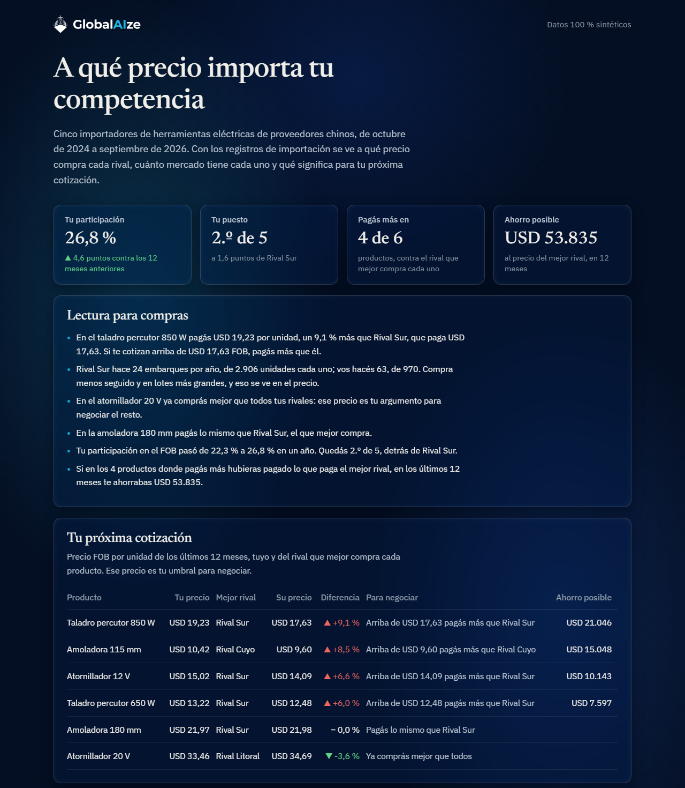
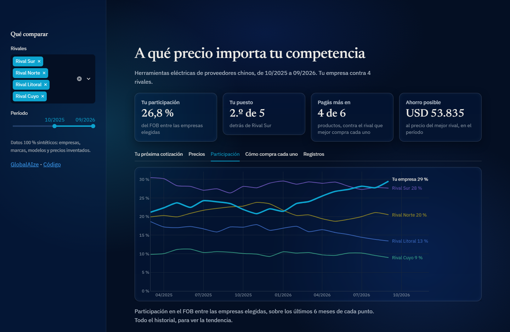
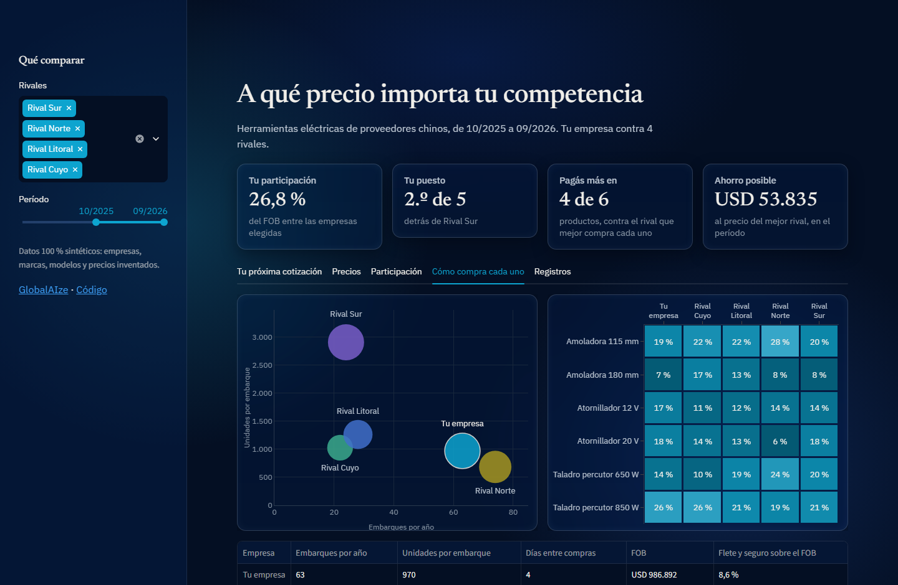

# competitor-import-benchmark

<p>
  <a href="README.md"></a>
  <a href="README.es.md"></a>
</p>

**See what your competitors pay for the same imports, how much of the market each one holds, and what it means for your next quote.**
By [GlobalAIze](https://www.globalaize.com). 100 % synthetic data. Runs with no external files and no API keys.

[](https://github.com/mauroemartinez/competitor-import-benchmark/actions/workflows/ci.yml)
[](LICENSE)



**[Open the live report](https://mauroemartinez.github.io/competitor-import-benchmark/)** (in Spanish, like the dashboard).

## The problem

Every importer who gets a quote from a supplier asks the same thing: is this a good price? The answer is already in the import records, because your rivals bring in the same products and declare what they pay. But the records are hard to read as they come:

- **Each importer describes the same product its own way**, and each brand uses its own model codes. "TALADRO PERC. 850 W" and "TALADRO/PERCUTOR DE 850 W 13 MM" are the same drill.
- **When a customs item groups several models, the whole value often sits on one line** and the others read zero. Read raw, the unit price per model comes out wrong, sometimes by a lot.
- **A big importer that buys a few large lots makes market share jump** from one quarter to the next and hides the trend.

## What it answers

- At what price each rival imports each product, FOB and CIF per unit.
- **Above what quote you pay more than the rival that buys best.** That price is your threshold for the next negotiation.
- Your share of the market against theirs, and where it is going.
- How each one buys: how often, in what lot sizes, and what freight and insurance cost them.
- What each one brings in, product by product.
- How much you would have saved at the best rival's price.

## How it works

1. **Recognize the product.** The product is identified by its type and its power or size, read from the description, not by the model code. That way the same thing is compared with the same thing, whatever each importer wrote.
2. **Split concentrated values.** When an item's value sits on one line, it is split across the item's lines by quantity times a reference price for each product: the one that same importer pays on lines that carry their own value, or the market's if there are none. Because the data is synthetic, the true value of every line is known, so the split can be audited:

   | Split method | Average error per line |
   |---|---|
   | Quantity times reference price (this repo) | **1.5 %** |
   | Quantity only | 23.5 % |

   Measured on the 301 lines whose value sat on another line.
3. **Measure.** Unit price per importer and product over the last 12 months, market share over a rolling 6 month window, purchase frequency, lot size, freight and insurance over FOB, and product mix.

## Results on the synthetic market

Five invented importers of power tools from Chinese suppliers, October 2024 to September 2026: 1,273 lines in 416 customs entries. "Tu empresa" (your company) against four rivals:

- **On the 850 W hammer drill you pay USD 19.23 per unit, 9.1 % more than Rival Sur (USD 17.63).** Any quote above USD 17.63 FOB means you pay more than they do.
- Rival Sur makes 24 shipments a year of about 2,900 units each; you make 63 of about 970. They buy less often and in bigger lots, and it shows in the price.
- On the 20 V cordless screwdriver you already buy better than every rival, and on the 180 mm grinder you match the best one: those prices are your argument for the rest.
- Your share of FOB went from 22.3 % to 26.8 % in a year. You are 2nd of 5, 1.6 points behind Rival Sur.
- On the 4 products where you pay more, buying at the best rival's price would have saved **USD 53,835** in the last 12 months.

## The dashboard

The same analysis in a Streamlit app: choose which rivals to compare, the period and the product, and download the lines behind every figure.





## The synthetic data

`competencia/datos.py` generates it with a fixed seed, so the same command always gives the same data. Each importer has its own profile: how often it buys, its lot size, whether it grows or shrinks, the price it gets for each product and what it brings in. Origin prices fall 4 % a year.

The records follow the shape of Argentine detailed import records: customs entry, item and sub-item, date, customs office, importer, origin, transport mode, Incoterm, tariff code, description, brand, model, units, FOB, freight, insurance and CIF. In 35 % of the items with several models, the whole value is declared on the first line, as in real records. The true value of every line is saved apart in `data/valores_reales.csv`, only to audit the split.

Everything is invented: companies, brands, models and prices. Tariff codes and customs office codes are illustrative.

## With your data

With real import records, we implement this for your company: your imports against your rivals', the price to beat for each product before every negotiation, updated every month.

## Stack

Python 3.12, pandas and NumPy for the analysis, Plotly for the charts, Jinja2 for the report, Streamlit for the dashboard. Tests with `unittest`, run on every push by GitHub Actions. The report is published on GitHub Pages from `docs/`.

## How to run

```bash
pip install -r requirements.txt

python -m competencia.datos       # regenerates data/ (same seed, same data)
python -m competencia.informe     # writes the report to docs/index.html
streamlit run streamlit_app.py    # the dashboard
python -m unittest discover -s tests -v
```

## Layout

```
competencia/
  datos.py        synthetic import records, with the true value of every line
  analisis.py     recognize the product, split values, prices, share, frequency, thresholds
  graficos.py     the charts, shared by the report and the dashboard
  informe.py      the HTML report (docs/index.html)
  marca.py        GlobalAIze colors and type
  formato.py      Argentine number format
streamlit_app.py  the dashboard
data/             registros_importacion.csv and valores_reales.csv
docs/             the published report and the README images
tests/            unittest, all offline
```

## Author

**Mauro E. Martinez**, [GlobalAIze](https://www.globalaize.com).

## License

MIT. See [LICENSE](LICENSE).

---

Want this analysis on your market? [www.globalaize.com](https://www.globalaize.com)
